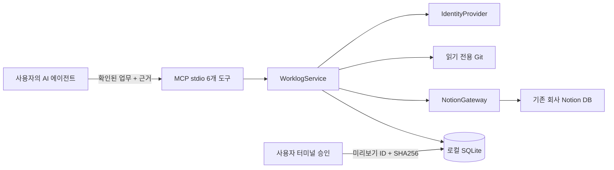

# WorkSync 구조

WorkSync는 LLM을 호출하지 않는다. Codex/Cursor/Claude Code가 자료를 분석하고 동일한 MCP 업무 형식으로 전달한다. 서버는 데이터 검증·권한 범위·미리보기 승인·Notion 저장·검증을 담당한다.

## 주요 경계

- `config/settings.ts`: 개인 설정 검증과 IdentityProvider. 토큰을 설정 파일에서 받지 않는다.
- `git/`: execFile 인자 배열로 Git 읽기. allowlist/realpath, literal pathspec, 날짜 경계, diff 상한·민감 경로 제외.
- `schemas/worklog.ts`: AI 분석 결과의 엄격한 Zod 형식. 날짜·상태 근거와 외부 자료 구분.
- `notion/`: 공식 SDK, 읽기 재시도·페이지네이션·속성 hydration, 실제 Sub-item 검증, 기존 옵션만 매핑.
- `services/worklog.ts`: 미리보기, 저장 사전 점검, 출처 예약, 쓰기 및 재검증.
- `services/approval.ts`: 고정 미리보기와 별도 사용자 승인. MCP에는 승인 생성 도구가 없다.
- `services/store.ts`: SQLite WAL 저장 이력, 출처별 고유 키, 프로세스 간 저장 잠금.
- `mcp/server.ts`: 6개 도구 등록과 오류 정제. stdout은 MCP 프로토콜 전용.

## 승인과 저장

미리보기에는 정규화한 입력, 정확한 Notion 속성, 수정 전 스냅샷, 설정 해시, 사용자, live/mock 모드, 생성 시각이 포함된다. 전체 JSON SHA-256을 서버에 보관한다. 30분 안에 사용자가 별도 대화형 CLI에서 전체 내용을 보고 해시 일부를 직접 입력해야 승인된다. 저장은 같은 ID/해시와 현재 설정을 검사한다. `approved:true` 입력은 허용 스키마에 없다. 기본 dryRun은 승인 전에도 쓰기 없이 확인할 수 있다.

실제 저장은 승인+서버 쓰기 설정이 모두 필요하다. 다른 실행의 저장 잠금, 기존 업무 변경, 옵션 변경, 부모 범위 이탈은 중단한다. 수정 전에는 모든 배치 항목을 사전 점검한다. 기존 일정 변경은 미리보기의 명시적 allowDateOverwrite가 필요하다. 리드는 설정하지 않아 기존 값을 유지한다. 참여자는 본인 단독 WorkSync 업무만 수정하고, 기존 복수 팀 값은 보존한다. 진행률이 percent 형식이면 0~100 입력을 0~1로 변환한다.

## 중복과 실패

출처 키는 `[kind, sourceId, id]`이고 데이터 소스별로 유일하다. 미리보기 배치, 허용된 부모들의 업무 메타데이터, 로컬 이력을 함께 검사한다. 제목 동일은 자동 병합이 아니라 확인 필요다. 텍스트의 유사 식별자는 자동 수정 근거로 쓰지 않는다. 본인 기존 업무와 실제 출처가 겹치고 새로운 근거가 더해지면 업데이트 후보로 제안한다.

원격 쓰기 전에 작업 의도와 출처 예약을 SQLite 트랜잭션으로 남긴다. 페이지 설명에 사람이 읽는 출처와 WorkSync 메타데이터(작업 ID, 원본 키, 소유자, 콘텐츠 해시)를 함께 기록한다. 재시도는 기존 작업 ID와 원격 마커를 찾아 승인 내용 전체를 재검증한다. 429는 제한된 Retry-After 재시도, 읽기 5xx는 최대 3회 재시도한다. 생성/수정의 5xx·네트워크 오류는 불명확 상태로 남기고 자동 재생성하지 않는다. 새 제목으로 우회해도 예약된 출처는 차단된다.

Notion은 여러 페이지를 묶는 원자적 트랜잭션이나 조건부 수정(CAS)을 제공하지 않는다. 배치 일부 성공은 이미 저장된 이력에서 복구한다. 사전 조회 직후 외부 사용자가 수정하는 경쟁 조건을 완전히 제거할 수 없다. 다른 PC/별도 stateDirectory에 의한 동시 요청까지 exactly-once라고 보장하지 않는다. 외부 자료 ID의 정확성은 에이전트와 사용자 확인에 의존한다. 허용되지 않은 부모나 접근 불가 DB 전체의 중복을 검색했다고 주장하지 않는다.

## 로컬 신뢰 모델

승인 CLI는 에이전트가 도구 인자로 승인 값을 넘기는 우회를 막는다. 같은 OS 사용자로 셸/파일/PTY를 완전히 제어하는 프로그램에 대해 암호학적 사용자 실재 확인을 제공하지 않는다. SQLite에는 업무 내용과 원본 식별자가 있으므로 개인 폴더 접근 권한과 장치 암호화를 적용하고 Git에 올리지 않는다. 토큰은 환경변수/.env에만 둔다. `.env` 역시 로컬 평문이므로 조직의 비밀 관리 정책을 따른다.

## 팀 공용 확장 (미구현)

Streamable HTTP+HTTPS 서버는 별도 진입점에서 구현한다. IdentityProvider를 인증된 OAuth 요청 컨텍스트 기반으로 교체하고, 사용자별 Notion ID·팀·허용 부모를 서버가 결정한다. NotionGateway와 업무 검증은 재사용한다. SQLite 단일 PC 이력은 공용 트랜잭션 DB/분산 잠금으로 교체하고, 승인 API는 로그인된 사용자와 내용 해시·만료·재사용 정책을 검증한다. Notion 토큰은 비밀 저장소에 암호화하고 감사 이력을 남긴다. 현재 로컬 설정을 다중 사용자 인증으로 사용하면 안 된다.
